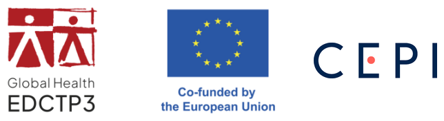

<!-- Translation of index.qmd (fr). Translate the text only: keep the code, the labels
     ({#sec-...}, {#fig-...}, #| label: ...) and file names unchanged. When the translation
     is complete, remove the box marked .translation-review and run
     py precourse/translations.py accept fr index.qmd -->

# Bienvenue {.unnumbered}

::: {.callout-note .translation-review}
## Traduction provisoire
Ce livre a été traduit de l'anglais et est en cours de relecture. Les remarques sont les bienvenues.
:::

*Également disponible en : [English](../en/index.html) · [Português](../pt/index.html)*

Ce livre contient le matériel d'**apprentissage préliminaire** de **TIMERA**, l'*Initiative de formation à la modélisation pour la riposte aux épidémies en Afrique*. Il résume les connaissances de base supposées acquises pendant la formation et est destiné à l'auto-apprentissage **avant le premier module en présentiel**, ainsi qu'à servir de référence pendant le programme.

| Chapitre | Contenu | Temps d'étude estimé |
|---|---|---|
| @sec-r | Bases de R et RStudio : objets, types de données, fonctions, tableaux de données, manipulation des données, graphiques, instructions conditionnelles et boucles | 15 à 25 heures pour les participants qui découvrent R ; 2 à 4 heures sinon |
| @sec-prelim-stats | Mesures de fréquence des maladies, données de surveillance, lois de probabilité, estimation, vraisemblance et régression pour des données de comptage | 6 à 10 heures |
| @sec-prelim-maths | Taux et probabilités, croissance exponentielle, dérivées et équations différentielles, équilibres, matrices et méthodes numériques | 6 à 10 heures |

Chaque chapitre contient une présentation concise de la matière, des exercices avec leurs solutions, une grille d'auto-évaluation et des références vers des ressources complémentaires.

## Préparation avant le premier module {.unnumbered}

1. Installer R, RStudio et les packages utilisés pendant la formation (@sec-setup).
2. Parcourir le glossaire (@sec-glossary), qui définit les principaux termes de l'épidémiologie et de la modélisation des maladies infectieuses utilisés pendant la formation.
3. Étudier les trois chapitres de ce livre. Les participants sans expérience préalable de R commenceront par les tutoriels interactifs mentionnés dans @sec-r, car les exercices des deux autres chapitres utilisent également R.
4. Utiliser la grille d'auto-évaluation à la fin de chaque chapitre pour déterminer si une étude complémentaire est nécessaire.
5. Identifier, dans son propre contexte professionnel, une question de santé publique à laquelle un modèle pourrait répondre. Cette question constitue la base du projet de la formation.

::: {.content-hidden when-meta="short-version"}
## Conventions {.unnumbered}

Le code est présenté dans des encadrés gris ; le résultat apparaît en dessous, précédé de `##`. Il est recommandé de taper le code plutôt que de le copier, afin d'en lire attentivement chaque ligne. Les exercices sont présentés dans des encadrés verts ; les solutions sont masquées et peuvent être affichées.
:::

Les références en *italique* à des chapitres du **livre du cours TIMERA** indiquent où un sujet est approfondi pendant la formation. Le livre du cours est disponible à l'adresse <https://github.com/Federica-Giardina/TIMERA>.

## Remerciements {.unnumbered}

{.funder-logos width="460px" fig-alt="Logos de Global Health EDCTP3, « Co-funded by the European Union » et de la CEPI"}

::: {.acknowledgement}
TIMERA bénéficie du soutien de l'entreprise commune Global Health EDCTP3 et de ses membres, au titre de la convention de subvention n° 101249114, et est cofinancé par l'Union européenne et la Coalition pour les innovations en matière de préparation aux épidémies (CEPI). Les points de vue et avis exprimés n'engagent toutefois que leur(s) auteur(s) et ne reflètent pas nécessairement ceux de l'Union européenne, de l'entreprise commune Global Health EDCTP3 ou de la CEPI. Ni l'Union européenne ni l'autorité chargée de l'octroi ne peuvent en être tenues pour responsables.
:::

## Licence {.unnumbered}

Ce livre est mis à disposition selon les termes de la [licence Creative Commons Attribution – Pas d'utilisation commerciale – Partage dans les mêmes conditions 4.0 International](https://creativecommons.org/licenses/by-nc-sa/4.0/deed.fr).
