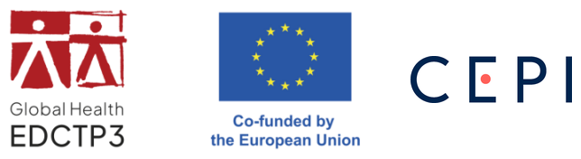

<!-- Translation of index.qmd (pt). Translate the text only: keep the code, the labels
     ({#sec-...}, {#fig-...}, #| label: ...) and file names unchanged. When the translation
     is complete, remove the box marked .translation-review and run
     py precourse/translations.py accept pt index.qmd -->

# Bem-vindo {.unnumbered}

::: {.callout-note .translation-review}
## Tradução provisória
Este livro foi traduzido do inglês e está em revisão. As observações são bem-vindas.
:::

*Também disponível em: [English](../en/index.html) · [Français](../fr/index.html)*

Este livro contém o material de **aprendizagem preliminar** do **TIMERA**, a *Iniciativa de Formação em Modelação para a Resposta a Epidemias em África*. Resume os conhecimentos de base pressupostos no curso e destina-se ao estudo autónomo **antes do primeiro módulo presencial**, bem como a servir de referência durante o programa.

| Capítulo | Conteúdo | Tempo de estudo estimado |
|---|---|---|
| @sec-r | Noções básicas de R e RStudio: objetos, tipos de dados, funções, *data frames*, manipulação de dados, gráficos, instruções condicionais e ciclos | 15 a 25 horas para participantes sem experiência em R; 2 a 4 horas nos restantes casos |
| @sec-prelim-stats | Medidas de frequência de doença, dados de vigilância, distribuições de probabilidade, estimação, verosimilhança e regressão para dados de contagem | 6 a 10 horas |
| @sec-prelim-maths | Taxas e probabilidades, crescimento exponencial, derivadas e equações diferenciais, equilíbrios, matrizes e métodos numéricos | 6 a 10 horas |

Cada capítulo contém uma apresentação concisa da matéria, exercícios com soluções, uma lista de autoavaliação e referências a recursos adicionais.

## Preparação antes do primeiro módulo {.unnumbered}

1. Instalar o R, o RStudio e os pacotes utilizados no curso (@sec-setup).
2. Ler o glossário (@sec-glossary), que define os principais termos da epidemiologia e da modelação de doenças infecciosas utilizados no curso.
3. Estudar os três capítulos deste livro. Os participantes sem experiência prévia em R devem começar pelos tutoriais interativos referidos em @sec-r, uma vez que os exercícios dos outros dois capítulos também utilizam o R.
4. Utilizar a lista de autoavaliação no final de cada capítulo para decidir se é necessário estudo adicional.
5. Identificar, no próprio contexto profissional, uma questão de saúde pública que possa ser abordada com um modelo. Esta questão constitui a base do projeto do curso.

::: {.content-hidden when-meta="short-version"}
## Convenções {.unnumbered}

O código é apresentado em caixas cinzentas; o resultado aparece por baixo, precedido de `##`. Recomenda-se escrever o código em vez de o copiar, pois isso incentiva a leitura atenta de cada linha. Os exercícios são apresentados em caixas verdes; as soluções estão recolhidas e podem ser expandidas.
:::

As referências em *itálico* a capítulos do **livro do curso TIMERA** indicam onde um tema é desenvolvido durante o curso. O livro do curso está disponível em <https://github.com/Federica-Giardina/TIMERA>.

## Agradecimentos {.unnumbered}

{.funder-logos width="460px" fig-alt="Logótipos da Global Health EDCTP3, «Co-funded by the European Union» e da CEPI"}

::: {.acknowledgement}
O TIMERA é apoiado pela Empresa Comum Global Health EDCTP3 e pelos seus membros, ao abrigo da convenção de subvenção n.º 101249114, e cofinanciado pela União Europeia e pela Coligação para as Inovações na Preparação para Epidemias (CEPI). Os pontos de vista e as opiniões expressos são, no entanto, apenas dos autores e não refletem necessariamente os da União Europeia, da Empresa Comum Global Health EDCTP3 ou da CEPI. Nem a União Europeia nem a autoridade que concede o financiamento podem ser responsabilizadas por eles.
:::

## Licença {.unnumbered}

Este livro está licenciado ao abrigo da [Licença Creative Commons Atribuição-NãoComercial-Partilha Igual 4.0 Internacional](https://creativecommons.org/licenses/by-nc-sa/4.0/deed.en).
